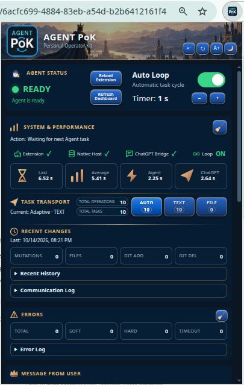
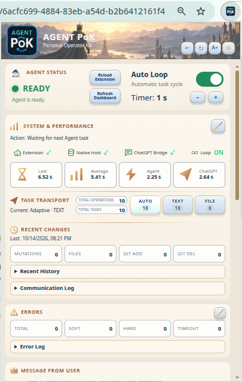
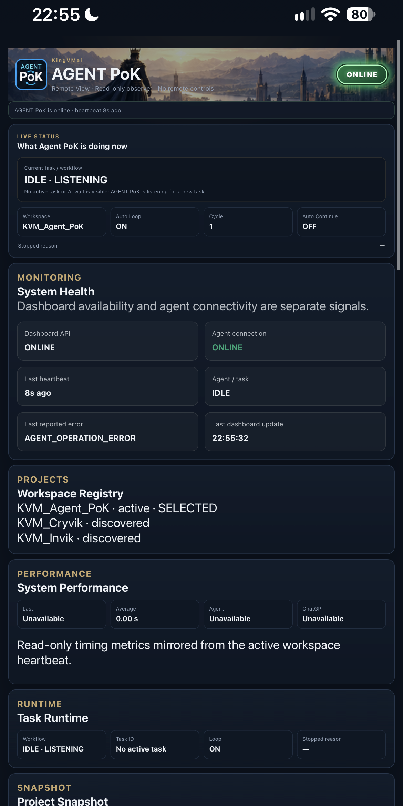

# Agent PoK

<!-- AGENT_POK_PORTFOLIO_DUAL_INTERFACES_20261010 -->
## Two interfaces, one local automation product

**Agent PoK by KingVMai** combines a **Chrome browser extension** with a **responsive local WebApp dashboard**:

- **Browser Extension (Chrome / Manifest V3):** the ChatGPT-facing interface that communicates with the authorized local Python agent through Native Messaging. This is the automation and task-execution side of the product.
- **WebApp (read-only monitoring dashboard):** a browser-based interface for reviewing agent connectivity, system health, heartbeat freshness, task runtime, recent activity, diagnostics, errors and discovered project workspaces. Its responsive layout supports desktop browsers and phones, including Safari on iPhone over a trusted local network.

The WebApp is a **locally hosted monitoring application**, not a public SaaS platform or a remote command-execution console. Workspace discovery does not authorize access or execution in another project.


**A local AI-to-workspace execution companion** — a KingVMai portfolio project.

**Status:** Operational, owner-verified private-use build · Chrome-first · Source code not publicly distributed

Agent PoK connects an AI conversation with a selected local development workspace. It is designed to reduce repetitive copying of terminal commands, file changes and diagnostic output, while keeping work inspectable and recoverable.

## The problem

AI-assisted development becomes slow when every file inspection, script execution and test result must be manually copied between the browser and a computer. Long conversations can also make project continuity difficult.

## What I built and validated

- A Chrome Manifest V3 extension communicating with a local Python Native Messaging host.
- Structured task requests and machine-readable results for selected workspace operations.
- Local file inspection and editing workflows, command execution for trusted development and validation through tests.
- Workspace activity, diagnostics, status and continuity controls.
- An owner-accepted dashboard with an 11-section User Manual and installed extension version shown in the existing footer.
- AUTO / TEXT / FILE task transport, a serialized user-message queue, and validated text/image-assisted task workflows.
- A separate local read-only WebApp dashboard for workspace status and diagnostics on a trusted LAN, including phone browsers.
- Project-state continuity using maintained documentation and an Initialize / Resume workflow.
- A maintained regression suite with **758/758 tests passing** on 14 October 2026 in the private development environment (not an independent security certification).

## Architecture (high level)

```text
Human + ChatGPT
      |
Chrome extension (JavaScript / Manifest V3)
      |
Native Messaging connection
      |
Local Python host
      |
Selected development workspace
      |
Structured execution result -> conversation
```

[Architecture details](docs/ARCHITECTURE.md) · [Validation and limits](docs/VALIDATION.md) · [Demo walkthrough](docs/DEMO.md)

## My contribution and how AI was used

**My role — product owner, requirements and acceptance:** I conceived Agent PoK, set the product direction and priorities, specified its capabilities and user experience, made decisions about scope and safety trade-offs, and defined acceptance criteria. I tested real Chrome workflows, reviewed diagnostic results, requested corrections and personally approved the private v1.0.0 release. I determined **what to build, why to build it, and whether the outcome met my requirements**.

**AI's role — end-to-end technical execution:** AI performed the software implementation, code modifications, test development and execution, documentation, terminal work, and Git/GitHub operations (including commits) under my direction. I do **not** claim to have personally programmed the underlying application. My contribution was to direct, evaluate and accept the AI-executed work.

**Working method:** requirements and priorities defined by me -> AI implementation -> regression tests and practical checks -> my feedback and acceptance -> AI-driven version control and release preparation. This case study demonstrates product ownership, requirements engineering, iterative QA, troubleshooting, AI orchestration and safety-aware decision-making. Source code and private runtime data are intentionally withheld.

## Screenshots and demo

Actual captures of the private-use Agent PoK product. The showcase PNG copies preserve the full original frames while omitting embedded image metadata. Ordinary local workspace paths and private ChatGPT conversation URLs may be visible; they are not authentication credentials.

### Chrome extension — dark and light themes

| Dark mode | Light mode |
| --- | --- |
|  |  |

[Dark 2](screenshots/showcase/dashboard-dark-2.png) · [Dark 3](screenshots/showcase/dashboard-dark-3.png) · [Light 2](screenshots/showcase/dashboard-light-2.png) · [Light 3](screenshots/showcase/dashboard-light-3.png) · [User Manual 1](screenshots/showcase/dashboard-manual-1.png) · [User Manual 2](screenshots/showcase/dashboard-manual-2.png)

### Local WebApp — Remote View



[Workspace activity](screenshots/showcase/remote-view-02.png) · [Diagnostics](screenshots/showcase/remote-view-03.png) · [Error history](screenshots/showcase/remote-view-04.png)

Remote View is a local read-only monitoring interface, not a public SaaS service or remote execution console. The captured phone layout does not constitute completed owner acceptance of the latest WebApp on a real iPhone.

### Videos

- [Short extension demo — 1 min 43 s (MP4)](media/showcase/agent-pok-short-demo.mp4)
- [Full workflow demo — 8 min 12 s (MP4)](media/showcase/agent-pok-full-demo.mp4)

These are demonstration recordings rather than independent certification. See [demo notes](docs/DEMO.md) and [validation limits](docs/VALIDATION.md).

## Current scope

Agent PoK is a personal local tool, not a public extension or hosted service. The source repository remains private. The owner confirmed the locally installed Chrome extension as **Agent PoK Private v1.0.0** on 14 October 2026. This remains a private local release, not a public distribution, Chrome Web Store release or public source-code publication. This showcase describes the project without releasing its internal engine, personal logs or credentials.

**KingVMai** · Project portfolio · 2026
